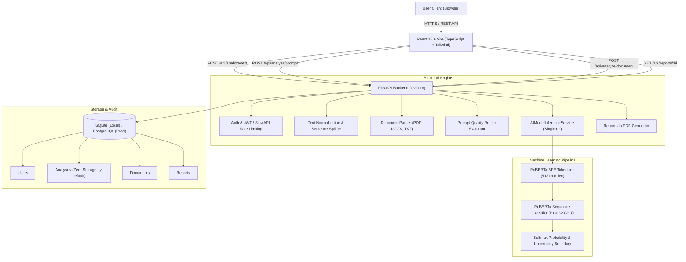

# CodeWithAnil — System Architecture

**Tagline:** Detect AI Writing. Analyze Text. Explore Authenticity.

## 1. High-Level Architecture Overview

CodeWithAnil is an end-to-end full-stack AI text analysis and authenticity verification platform. Unlike superficial wrappers that call external proprietary APIs or simulate percentages, CodeWithAnil executes local transformer neural network inference on CPU using PyTorch and Hugging Face Transformers.

## 2. Core Subsystems

### 2.1 Frontend Subsystem (React 18 + Vite)
- **Framework:** React 18 with TypeScript and Vite.
- **Styling:** Custom Tailwind CSS palette with dark navy (`#060914`, `#0b1120`), electric blue (`#0ea5e9`, `#38bdf8`), and brand purple (`#a855f7`).
- **State Management:** React Contexts for Theme (Dark/Light mode persistence) and Authentication (JWT session management).
- **Visualization:** Recharts score distributions and custom CSS probability gauges with uncertainty margin highlights.

### 2.2 Backend Subsystem (FastAPI)
- **Framework:** FastAPI with Uvicorn.
- **Validation:** Pydantic v2 schemas for all requests and responses.
- **Rate Limiting:** SlowAPI token bucket limiter configured per client IP.
- **ORM:** SQLAlchemy 2.0 supporting SQLite for development and PostgreSQL for production.

### 2.3 Machine Learning Inference Engine
- **Model Checkpoint:** `Hello-SimpleAI/chatgpt-detector-roberta` (trained on HC3 benchmark) with fallback compatibility for `roberta-base-openai-detector`.
- **Runtime:** PyTorch in `torch.inference_mode()`, running float32 tensor operations on CPU without GPU requirements.
- **Calibration:** Raw logits converted through softmax with an explicit uncertainty band (40% - 60%) triggering an `Inconclusive` classification label.
- **Sentence Analysis:** Text is segmented into sentences and evaluated individually to highlight potential LLM cadence patterns while warning the user that isolated sentences cannot prove authorship.

### 2.4 Privacy & Data Retention Policy
- Unauthenticated submissions are processed strictly in-memory and immediately discarded.
- Authenticated users may choose to persist text in the database for auditing and PDF report generation.
- Full deletion capabilities are provided via `DELETE /api/analysis/:id`.
